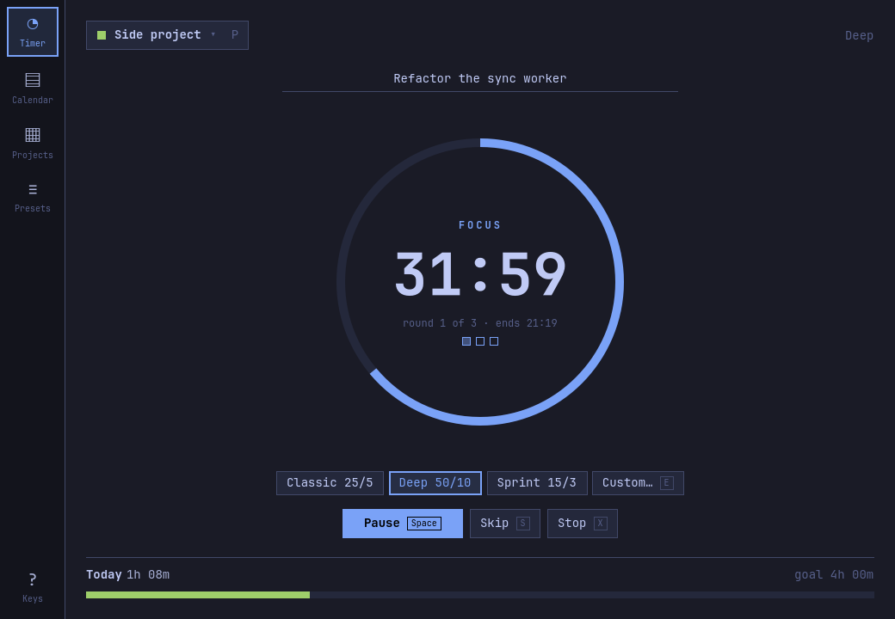
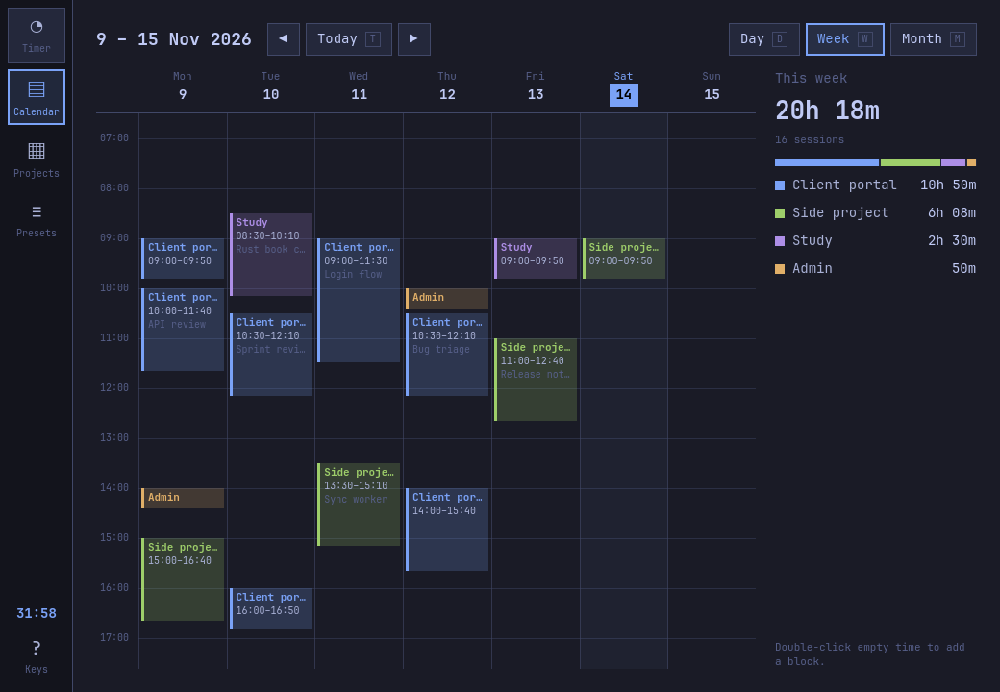
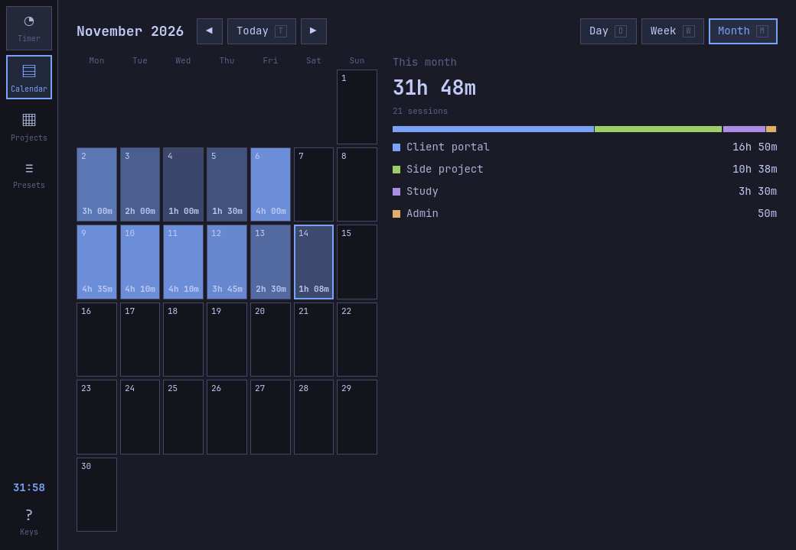
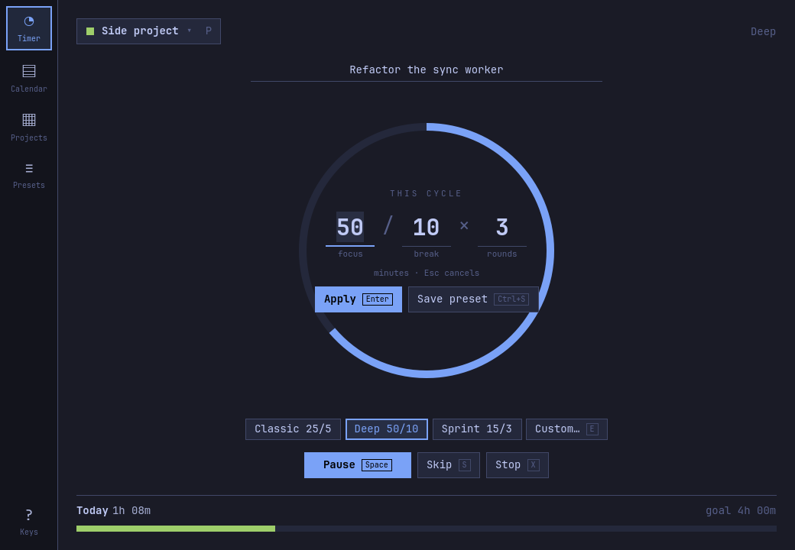
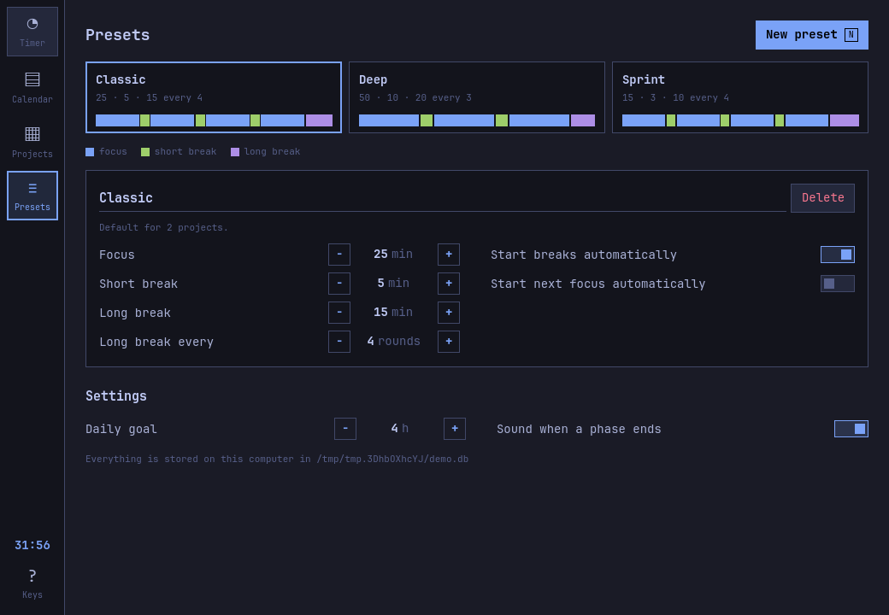
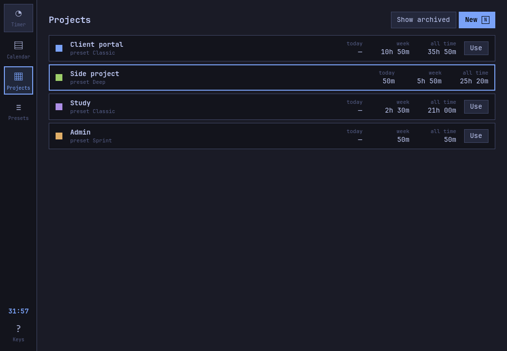

# Tomate

**A Pomodoro timer and time tracker for [Omarchy](https://omarchy.org).**
Pick a project, focus, take breaks with whatever timings you like, and see on
a calendar exactly when the work happened. Think of it as the Mac app
*Session* and *Clockify* combined, built natively for the Omarchy desktop.



Tomate is built the way Omarchy's own apps are (Hype, Monologue, Omacut): one
small C++ / Qt Quick binary that follows your Omarchy theme live, matches
Hyprland's window corners, works well from the keyboard, and keeps all your
data in one local SQLite file. No account, no cloud, no Electron.

> **Made for Omarchy.** Tomate runs on Omarchy (Arch Linux + Hyprland). It
> reads the current Omarchy theme, uses Hyprland to place its window, and
> adds a widget to the Omarchy shell bar. The timer and calendar also work on
> other Linux desktops, without those integrations.

## Features

- **Projects**, each with a colour from your theme and a default preset.
- **Presets you fully control**: any focus length, short break and long
  break, a long break every N rounds, and whether breaks and the next focus
  start on their own. Ships with Classic 25/5, Deep 50/10 and Sprint 15/3.
- **Custom times for one cycle**: click the countdown (or press `E`), type
  e.g. 40 / 8 × 2 and press Enter. Your preset stays as it is; `Ctrl+S` saves
  the custom times as a new preset.
- **Calendar** with day, week and month views. Every focus block is drawn
  in its project's colour. Click a block to fix its project, times or note;
  double-click empty time to add time you worked away from the computer.
- **Status bar widget** for the Omarchy shell: a small ring that empties as
  the block runs, the time left and the project. Click to start or pause,
  right-click to bring the window to you.
- **Honest time**: the timer stores timestamps, not a ticking counter, so a
  suspend, crash or restart never loses or inflates time. Paused time
  doesn't count, and stopping early keeps the minutes you actually worked.
- **Notifications and a sound** when each block or break ends, even with the
  window closed (the bar widget keeps checking the timer).
- **A command line** for scripts, key binds and agents: status, start/pause,
  reports and CSV export.

## Screenshots

| | |
| --- | --- |
|  |  |
| **Week**: one block per focus session, totals per project | **Month**: a heatmap of focus time against your daily goal |
|  |  |
| **Custom times** for the current cycle only (`E`) | **Presets**, each cycle drawn to scale |



Screenshots use made-up data and the Tokyo Night theme; Tomate takes on
whichever Omarchy theme you use.

## Install

You need Omarchy (or Arch Linux with Hyprland) and the Qt 6 packages
Omarchy already ships.

```sh
git clone https://github.com/kevin-weitgenant/tomate.git ~/Work/tomate
cd ~/Work/tomate
bin/install        # builds and installs the package; asks for your sudo password
bin/install-bar    # adds the widget to the Omarchy bar, next to the clock
```

Then open **Tomate** from the app launcher (`Super + Space`).

If `qmake6` is missing: `omarchy pkg add base-devel qt6-base qt6-declarative qt6-wayland`.

To install for your user only, without sudo:

```sh
bin/build
install -Dm755 build/tomate ~/.local/bin/tomate
install -Dm644 pkgbuild/tomate.svg ~/.local/share/icons/hicolor/scalable/apps/tomate.svg
sed "s|^Exec=tomate|Exec=$HOME/.local/bin/tomate|" pkgbuild/tomate.desktop > ~/.local/share/applications/tomate.desktop
```

## Using it

1. **Create a project** on the Projects screen (`3`, then `N`): name, colour
   and default preset.
2. **Pick it** on the Timer screen (`P`) and press `Space`. Optionally type
   what you're focusing on; it becomes the block's note on the calendar.
3. **Close the window whenever you like** (`Super + W`). The timer keeps
   running in the bar widget, which also sends the notification when the
   block ends.
4. **Review your week** on the Calendar (`2`). Fix anything that's wrong by
   clicking it.

Opening Tomate again, from the launcher or by right-clicking the bar widget,
brings the window to the workspace you're on instead of switching workspaces,
and there is only ever one Tomate window.

### The bar widget

| What you see | Meaning |
| --- | --- |
| accent ring + `31:36 · Side project` | focusing; the ring empties as time runs out |
| green ring + `04:12` | short break (purple for a long break) |
| dimmed ring with a pause sign | paused; paused time doesn't count as work |
| yellow `Focus ready`, flashing 3 times | a break ended and the next block waits for you |
| a small ring alone | idle; hover for today's total |

Left-click starts, pauses or resumes. Right-click brings the Tomate window to
you. Hover shows the round, end time, note and today's total against your
goal. Remove it with `omarchy plugin disable tomate.bar`.

### Keys

| Key | Action |
| --- | --- |
| `Space` | start / pause / resume |
| `S` | skip to the next phase |
| `X` | stop and log what was done |
| `E` | custom times for this cycle |
| `P` | switch project |
| `1` – `4` | Timer · Calendar · Projects · Presets |
| `←` `→` `T` | previous / next / today (calendar) |
| `D` `W` `M` | day / week / month (calendar) |
| `N` | new project or preset |
| `?` | all shortcuts |
| `Q` | quit |

A Hyprland bind to start or pause from anywhere, in `~/.config/hypr/bindings.lua`:

```lua
o.bind("SUPER + ALT + P", "Tomate start/pause", "tomate toggle")
```

## Command line

```sh
tomate                     # open the window, or bring it to this workspace
tomate status [--json]     # what the timer is doing (the bar widget uses this)
tomate toggle              # start or pause
tomate start | pause | skip | stop
tomate show                # bring the window here, opening it if needed
tomate project "Side project"
tomate report --week [--json]          # also --today, --month
tomate export --csv --from 2026-11-01 > hours.csv
```

Every command exits 0 on success and 1 on error, with errors on stderr.

## How it works

- **One source of truth.** The timer is a handful of timestamps (when the
  phase started, when it was paused) in the SQLite database. The window, the
  bar widget and the CLI all read and write that file, so they always agree;
  whichever notices a phase ending first records it and sends the
  notification, inside a database lock, so it happens once.
- **No invented work.** If nothing was running when a break ended (say, the
  laptop was asleep for hours), the next focus block waits for you instead
  of starting in the past and logging time you didn't work. Blocks stopped
  within their first minute leave nothing on the calendar.
- **Your data.** Everything is in `~/.local/share/tomate/tomate.db`. Back up
  that one file; export to CSV any time. Set `TOMATE_DB` to use another file.

## Development

```sh
bin/build          # build/tomate
bin/test           # timer engine, theme and translator tests, offscreen
bin/screenshots    # regenerate docs/screenshots from made-up demo data
bin/install-bar    # copy bar/tomate.bar into the Omarchy shell and place it
```

```text
src/engine.*     the timer: phases, rounds, pause, catch-up, sessions
src/db.*         SQLite schema, migrations and first-run presets
src/backend.*    what the QML sees: live timer, projects, presets, sessions
src/cli.*        tomate status / toggle / report / export / show
src/desktop.*    Hyprland: one window, opened on the workspace in view
src/theme.*      follows the Omarchy theme and Hyprland rounding live
src/*.qml        Timer, Calendar, Projects and Presets screens
bar/tomate.bar   the Omarchy shell bar widget (QML plugin)
tests/           Qt Test cases with a fake clock
```

The original design notes, with interactive mock-ups, are in
[`docs/plan.html`](docs/plan.html) and
[`docs/bar-widget-plan.html`](docs/bar-widget-plan.html).

## License

MIT. Theme-following and translation code follow Omacut and Monologue
(MIT, David Heinemeier Hansson).
