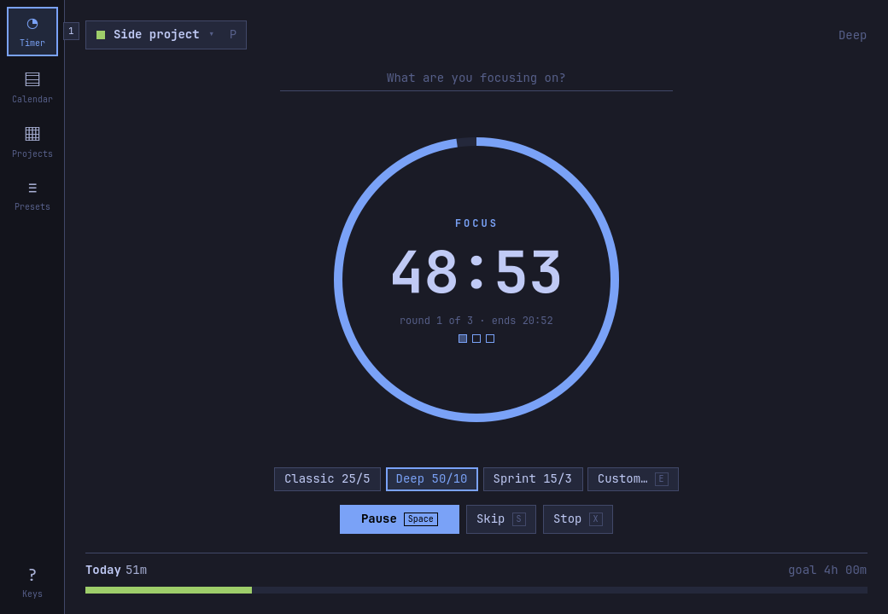
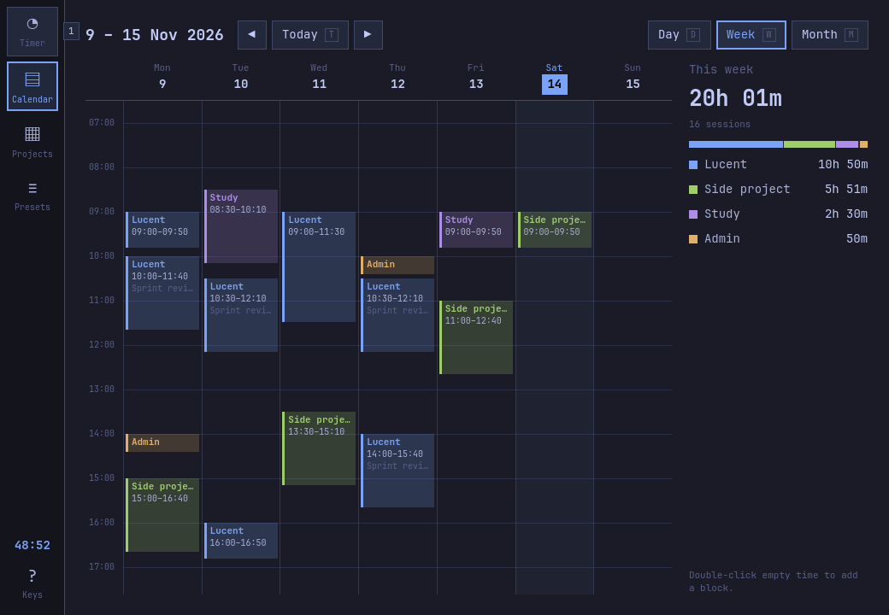

# Tomate

A Pomodoro timer that keeps a diary. Pick a project, focus, take breaks with
whatever timings you like, and see on a calendar exactly when the work
happened. Built for Omarchy: it follows your theme live, works well from the
keyboard, and keeps everything in one local SQLite file.




## What it does

- **Projects** with a colour from your theme and a default preset.
- **Presets**: any focus, short-break and long-break length, a long break
  every N rounds, and whether breaks or the next focus start on their own.
- **Custom times for one cycle**: click the countdown or press `E`, type
  e.g. 40 / 8 × 2, press Enter. `Ctrl+S` keeps it as a preset.
- **Calendar**: day, week and month views. Click a block to fix it,
  double-click empty time to add time worked away from the computer.
- **Honest time**: the timer saves timestamps, not a ticking counter, so a
  suspend, crash or restart never loses or inflates time. Stopping early
  keeps the minutes you actually worked.

## Keys

| Key | Action |
| --- | --- |
| `Space` | start / pause / resume |
| `S` | skip to the next phase |
| `X` | stop and log what was done |
| `E` | custom times for this cycle |
| `P` | switch project |
| `1`–`4` | Timer · Calendar · Projects · Presets |
| `←` `→` `T` | previous / next / today (calendar) |
| `D` `W` `M` | day / week / month (calendar) |
| `N` | new project or preset |
| `?` | all shortcuts |
| `Q` | quit |

## Command line

```sh
tomate status --json      # for a status bar: text, tooltip, class, percentage
tomate toggle             # start or pause; good for a Hyprland bind
tomate start | pause | skip | stop
tomate project "Side project"
tomate report --week [--json]
tomate export --csv --from 2026-11-01 > hours.csv
```

A Hyprland bind to start or pause from anywhere:

```ini
bindd = SUPER ALT, P, Tomate toggle, exec, tomate toggle
```

## Data

Everything lives in `~/.local/share/tomate/tomate.db` (set `TOMATE_DB` to
use another file). It is the only thing to back up.

## Build

```sh
bin/build      # build/tomate
bin/test       # engine, theme and translator tests, offscreen
bin/install    # makepkg -fsi: installs it into the app launcher
```
